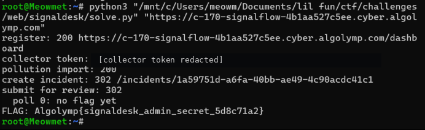

# SignalDesk — NFKC Prototype Pollution to Admin-Bot XSS

**Category:** Web · **Event:** AlgoCyber / Algolymp 2026  
**Flag:** `Algolymp{signaldesk_admin_secret_5d8c71a2}`

## Application

SignalDesk was an incident-tracking site where analysts could submit an incident for review by an authenticated administrator bot. It also allowed users to import JSON preferences and collect messages using a per-user `/hooks/<token>` endpoint.

## Vulnerability chain

### 1. Unicode normalization *after* a raw-key security check

The imported configuration passed through recursive merge logic. The code reportedly checked a blocklist against the original JSON key, then applied `normalize('NFKC')` before using the key. The following fullwidth key was not the ASCII string `__proto__`, but normalized to it:

```json
{
  "＿＿ｐｒｏｔｏ＿＿": {"renderMode":"trusted"}
}
```

This polluted inherited object state with `Object.prototype.renderMode = 'trusted'` in the vulnerable process.

### 2. Inherited trust property

The timeline renderer checked `block.renderMode === 'trusted'` to decide whether to emit content as raw HTML. **Section** blocks reportedly omitted their own `renderMode`, causing a security decision to depend on the polluted prototype instead of explicit trusted metadata.

### 3. A second normalization mismatch and stored XSS

Heading validation rejected literal `<` and `>`, but performed NFKC normalization only later when rendering. Fullwidth `＜script＞` and `＜/script＞` became actual delimiters after validation, and the timeline reached an unescaped EJS output path (`<%- renderedTimeline %>`).

The stored script was displayed to an authenticated admin bot. It fetched `/admin/flag` and posted the returned response body to the same challenge instance's collection endpoint, `/hooks/<collector-token>`.

### 4. Exploit and result

The [`solve.py`](solve.py) registered a fresh analyst, obtained its collector token, imported the crafted preferences, submitted an incident with a section-heading payload, requested admin review, and polled `/inbox`.

Running the script produced:

```text
register: 200
pollution import: 200
create incident: 302
submit for review: 302
poll 0: no flag yet
FLAG: Algolymp{signaldesk_admin_secret_5d8c71a2}
```



The collector token is masked in the screenshot. The `/hooks/` collector belongs to the CTF application.

## Prevention

Normalize before validation; prevent prototype-key merges (`__proto__`, `constructor`, `prototype`) after normalization; never use an inherited trust property; escape at the final HTML context; and sandbox privileged reviewer sessions.

## Reproduction

```bash
python3 -m pip install requests
python3 solve.py https://<assigned-ctf-instance>
```

The script targets the assigned CTF instance.
